> Archived original analysis and manuscript. The [current epidemiological study](README.md) uses the preserved results.

# Hospital genomic surveillance with simulation and public Klebsiella genome validation

**Vusumuzi Mabasa**

[Public genome results](#public-genome-case-study-and-publication-concordance) | [Reproducibility](#reproducibility) | [Word report](report/Hospital_AMR_Report.docx)

## Abstract

**The simulation experiments use synthetic data. The public case study uses published bacterial genome assemblies from the NIH outbreak. This independent project has no institutional affiliation or endorsement.** We evaluated candidate outbreak links using genetic distance alone and genetic distance combined with hospital, ward and collection-date information. One hundred independently seeded populations of 150 isolates were assessed under four paired observation scenarios and three prespecified thresholds. A separate compact Nextflow experiment processes artificial short-read data with standard sequencing tools.

At the primary toy threshold, adding epidemiological evidence increased mean precision from 17.7% to 93.1% in the baseline scenario, with sensitivity of 78.7% for both methods. Missing metadata reduced integrated sensitivity to 43.1%. These results quantify consequences of the simulation assumptions rather than performance in actual hospitals.

In a separate public-data case study, all 12 NIH outbreak assemblies were assigned ST258 and 12 carried KPC-family genes. The common chromosome contained 5,211,693 callable sites and 42 variable sites. Publication concordance and the limits of assembly-based validation are reported separately from the simulations.

## Introduction

Healthcare-associated infection surveillance links laboratory findings to the place and time of patient care. Related bacterial isolates can indicate a common circulating lineage, an outbreak, or other shared ancestry. Genetic similarity therefore needs epidemiological interpretation. The work is motivated by the surveillance and bioinformatics activities described by the NICD Centre for Healthcare-Associated Infections, Antimicrobial Resistance and Mycoses [1].

The clinical motivating organism is carbapenem-resistant Klebsiella pneumoniae. However, the generated core haplotypes are random computational sequences, not reconstructed K. pneumoniae genomes. The aim is methodological: determine when metadata improve candidate-link precision and when incomplete ascertainment or poor quality limits recovery of known links.

A second objective is to assess whether the separate public-genome workflow recovers established lineage and carbapenemase findings from a published hospital outbreak. This case study adds observed bacterial sequence evidence while retaining the distinction between known simulated links and published outbreak context.

## Methods

### Population and sequence model

Each synthetic population contains 150 distinct people with one isolate each, three hospitals, three ward categories and collection dates within 2025. Three planted clusters contain 12 isolates each and share a hospital, ward and a 21-day collection period. Twelve lineage founders are formed by changing 60 sites in a common 6,000-site random ancestor. Each isolate receives Poisson(2) private substitutions. Background isolates can share founders with outbreak isolates; six deliberately close background comparators have collection dates outside the outbreak windows. Cluster membership is an evaluation label and does not enter detection.

$$d_{ij}=\sum_{\ell=1}^{L}\mathbf{1}(G_{i\ell}\ne G_{j\ell}),\qquad L=6000.$$

This deliberately simple, nonrecombining ancestry model omits real bacterial population structure, accessory-genome diversity and within-host evolution. All background members of the same founder can be genetically close. The resulting challenge is intentionally unfavourable to genomic-only inference; a large precision advantage should not be generalised to every surveillance setting.

### Observation and prespecified detection rules

Baseline per-isolate site call probability is 0.995. Poor quality draws it uniformly from 0.87 to 0.99 and increases sequencing-error contributions. For each pair, jointly callable sites are binomial with success probability q_ij=q_i q_j; true differences are thinned with the same probability and independent false differences follow a Poisson distribution. Pair-level draws are an approximation and need not form a globally consistent alignment.

$$C_{ij}\sim\operatorname{Binomial}(L,q_iq_j),\quad \widetilde d_{ij}\sim\operatorname{Binomial}(d_{ij},q_iq_j)+\operatorname{Poisson}(2Lq_iq_j e).$$

Error rate e is 0.000001 at baseline and 0.0002 under poor quality. Pairs require at least 90% jointly callable sites. Genomic cutoffs 2, 5 and 10 are evaluated throughout, with 5 specified as the primary illustrative cutoff. They apply to the toy model and are not recommended clinical thresholds. Incomplete sampling retains each isolate independently with probability 0.6. Missing metadata deletes each ward independently with probability 0.25. Scenarios share the same population and observation random seed within replicate; they are paired stress tests, not independent cohorts.

$$A_{ij}=\mathbf{1}(\text{both sampled})\mathbf{1}(C_{ij}/L\ge0.90)\mathbf{1}(\widetilde d_{ij}\le k).$$

$$B_{ij}=A_{ij}\mathbf{1}(h_i=h_j)\mathbf{1}(w_i=w_j\text{ observed})\mathbf{1}(|t_i-t_j|\le30).$$

A and B define genomic-only and integrated candidate links. A planted true link joins two members of the same planted cluster, yielding 3 times choose(12,2), or 198 true pairs. An unsampled, failed-QC or metadata-ineligible true pair counts as missed in population sensitivity. Conditional sensitivity among sampled true pairs is exported separately. Precision is undefined when no candidate links are called; its valid-replicate count is retained. Connected components are provided only as descriptive candidate clusters: single-linkage chaining can join isolates whose direct pair fails the rule.

$$\operatorname{Precision}=\frac{TP}{TP+FP},\qquad\operatorname{Sensitivity}_{all}=\frac{TP}{198},\qquad\operatorname{Sensitivity}_{sampled}=\frac{TP}{N_{true,sampled}}.$$

Means and 95% t Monte Carlo intervals use independent replicate-level estimates. Paired differences use integrated minus genomic-only estimates within the same replicate. These intervals describe precision of simulated averages, not independent-pair uncertainty or clinical confidence intervals. Missing-metadata sensitivity is expected to scale approximately with 0.75 squared, and population sensitivity under 60% independent isolate sampling with 0.60 squared.

### Sequencing experiment and AMR controls

Twelve artificial 30-kb core segments, with two related groups and background comparators, form a separate pipeline-validation dataset. Ten have expected depth 28 and two have expected depth 2. The read generator supplies 150-bp paired reads, insert length 320 and substitution error 0.0001. These sequences are non-biological fixtures. Real public blaKPC-2 and blaNDM-1 nucleotide reference records from NCBI AMRFinderPlus release 2026-08-07.1 serve as computational accessory-sequence positive controls; accessions and SHA256 checksums are retained [2].

Nextflow coordinates fastp QC, BWA alignment, samtools sorting and depth, haploid bcftools calls, depth masking and consensus. Calls require quality 20 and depth 5; core positions below depth 5 become N. Four selected fixtures undergo SPAdes assembly and BLASTn screening of the two targets, using at least 95% identity and 90% reference-length coverage. This targeted screen is not an executed AMRFinderPlus analysis or a complete resistome. Gene presence does not establish drug susceptibility.

IQ-TREE estimates a GTR+G maximum-likelihood tree from QC-passing observed full-core alignments with 1,000 ultrafast bootstraps and a fixed seed [3]. The separate R neighbour-joining tree uses complete truth distances; it is arbitrarily rooted for display and does not establish transmission direction. Tool installation environments and execution records accompany the workflow.

### Descriptive surveillance and clinical associations

One prespecified population illustrates monthly isolate counts, Wilson intervals for simulated resistance proportions and Fisher testing of hospital differences. Synthetic gene carriage depends on hospital and planted-cluster membership; binary phenotypic non-susceptibility probabilities are 0.90 in carriers and 0.08 otherwise. These are not measured MICs. Mortality is generated by logistic(-2.5+0.5 gene+0.8 severity+0.015(age-55)), then analysed using logistic regression with gene, age, severity and hospital. The single-cohort Wald intervals and P values are exploratory. No causal effect, incidence rate, clinical prediction accuracy or real resistance burden is inferred.

### Public Klebsiella pneumoniae genome case study

An independent assembly-based reanalysis used twelve public genomes from the 2011 NIH Clinical Center outbreak described by Snitkin et al. [5]. The selection was fixed before analysis: the twelve lowest-numbered available KPNIH1–18 assemblies in the captured NCBI snapshot, with KPNIH3 absent. This is a convenience subset of the original study, not an independent validation cohort. Accession versions, BioSamples, source URLs and SHA256 checksums are recorded. KPNIH1 and KPNIH10 use version 2 complete assemblies released in 2014; the other ten use version 1 draft assemblies. Therefore this is not an exact rerun of the original 2012 assembly set.

The prespecified publication checks were the reported ST258 lineage and KPC carbapenemase family. These expectations were fixed before the observed typing and AMR calls were examined. The paper also reported 41 variable sites among 18 outbreak isolates. We compare the broad low-diversity pattern with that finding, without requiring an identical variant count from a different subset, reference and masking strategy.

Nextflow coordinates the real-data workflow separately from the synthetic experiments. BLASTn identifies exact, full-length alleles at gapA, infB, mdh, pgi, phoE, rpoB and tonB. A sequence type is assigned only when each locus has a unique allele and the seven-locus profile matches the accession-locked PubMLST mirror. Missing or ambiguous alleles remain unassigned. The pinned mirror commit is dd2ae883f721b9049fbbe4ab92e2db1ba9c100ed [6].

AMRFinderPlus 4.2.7 performs translated nucleotide searches of the complete submitted assemblies against database 2026-08-07.1 [2]. The database source-file manifest is retained. AMR gene calls are distinguished from stress-associated elements in the full output. No organism-specific resistance-mutation search, phenotypic susceptibility prediction or plasmid reconstruction is claimed.

The largest complete KPNIH1 contig, CP008827.1, supplies the 5,394,056-base chromosome reference. Assembly contigs are aligned with minimap2 asm5. Unmapped, secondary, supplementary and mapping-quality-below-30 alignments are excluded. Reference positions with multiple primary mappings, ambiguous sequence or an indel within five bases are masked. Off-diagonal self-BLAST alignments of at least 100 bases and 95% identity define an additional shared repeat mask. Mapping quality here measures alignment confidence; it is not a raw-read base-quality assessment.

An assembly passes the prespecified callability gate when at least 90% of the chromosome has an unambiguous projected base before the shared repeat mask. The common core retains positions callable in every passing assembly and outside repeats. At least 80% of the reference must remain for the cohort comparison. Pairwise distances use this same denominator for every pair:

$$\mathcal C=\{\ell:M_\ell=0,\ G_{i\ell}\in\{A,C,G,T\}\ \text{for every passing }i\},\qquad d_{ij}=\sum_{\ell\in\mathcal C}\mathbf1(G_{i\ell}\ne G_{j\ell}).$$

IQ-TREE estimates a GTR+G maximum-likelihood tree from the full common-core alignment, including constant sites, with 1,000 ultrafast bootstrap replicates and identical sequences retained. Constant-site inclusion avoids SNP-only ascertainment bias. The display root is arbitrary. Recombination is not inferred; repeat and indel masking do not substitute for a recombination analysis. The SNP alignment and reference-position table are exported for audit.

R provides descriptive summaries, publication-concordance tables and ggplot figures. Counts, medians, interquartile ranges and ranges describe this selected outbreak subset. Related isolates and pairwise distances are not treated as independent observations, and no population-level confidence intervals, association tests or transmission sensitivity estimates are calculated. NCBI species labels are retained; species identification, contamination and raw-read depth are not independently assessed from these assemblies.

## Results

All 100 populations completed, giving 400 scenario observations and 2,400 threshold-method evaluations. The primary comparison demonstrates that close relatives outside planted outbreaks create false candidate links under a genomic-only rule. Metadata improve precision in this deliberately challenging model.

| Scenario | Genomic-only precision | Integrated precision | Genomic-only sensitivity | Integrated sensitivity |
|---|---:|---:|---:|---:|
| Good quality | 17.7% | 93.1% | 78.7% | 78.7% |
| Poor sequence quality | 17.3% | 92.1% | 10.6% | 10.6% |
| 60% isolate sampling | 17.7% | 93.0% | 28.3% | 28.3% |
| 25% missing ward data | 17.7% | 93.1% | 78.7% | 43.1% |

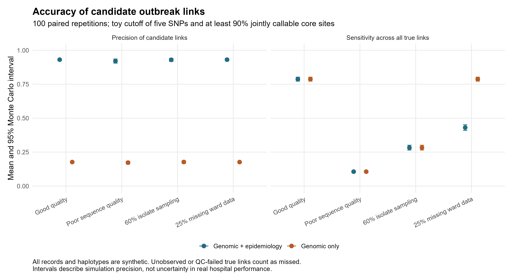

Increasing the SNP threshold changes candidate-link recovery and false positives. The full prespecified grid is retained; no cutoff is optimised using the evaluation labels.

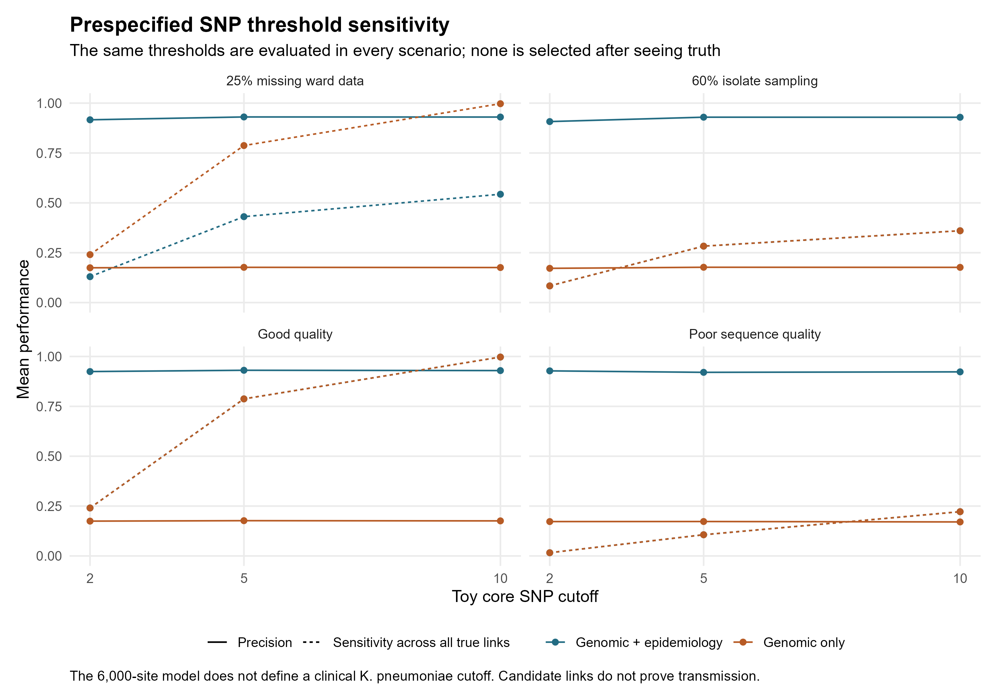

Paired contrasts isolate the change caused by requiring epidemiological agreement. The apparent gain in precision comes with lost true links when ward information is missing. Quality filtering and incomplete sampling limit both methods.

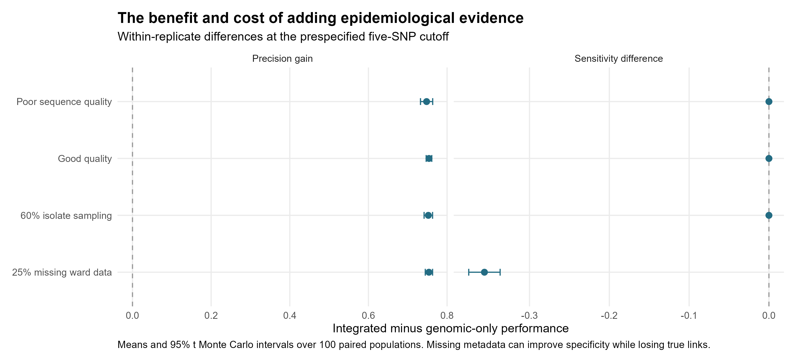

The first seeded population shows temporal concentration of planted clusters against year-round background observations. These counts describe sampled isolates and cannot estimate incidence without population or patient-day denominators.

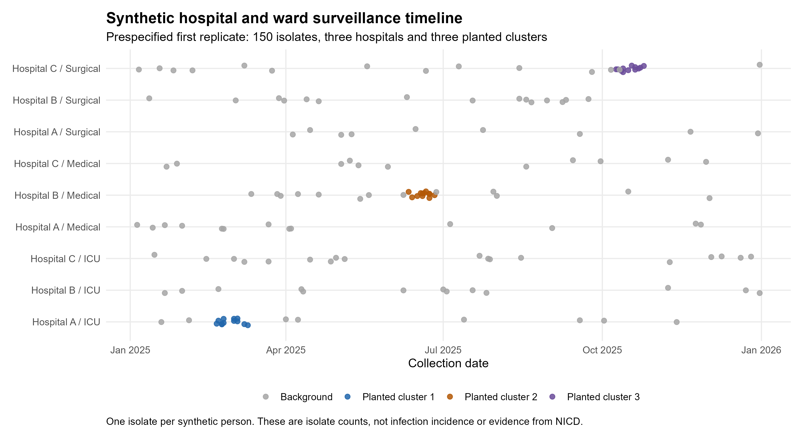

Genetically close background isolates illustrate why a phylogenetic grouping alone cannot identify a transmission chain. The full 150-tip Newick tree is retained; 36 prespecified tips are shown for readability.

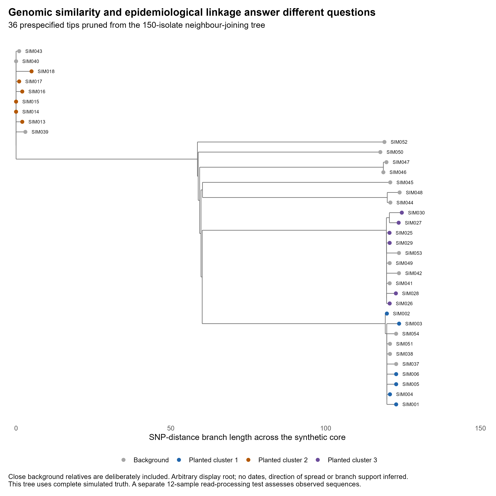

The SNP-distance heatmap highlights close background relatives as well as the planted groups. The heatmap and tree are descriptive views of the same complete-truth data, not independent validation.

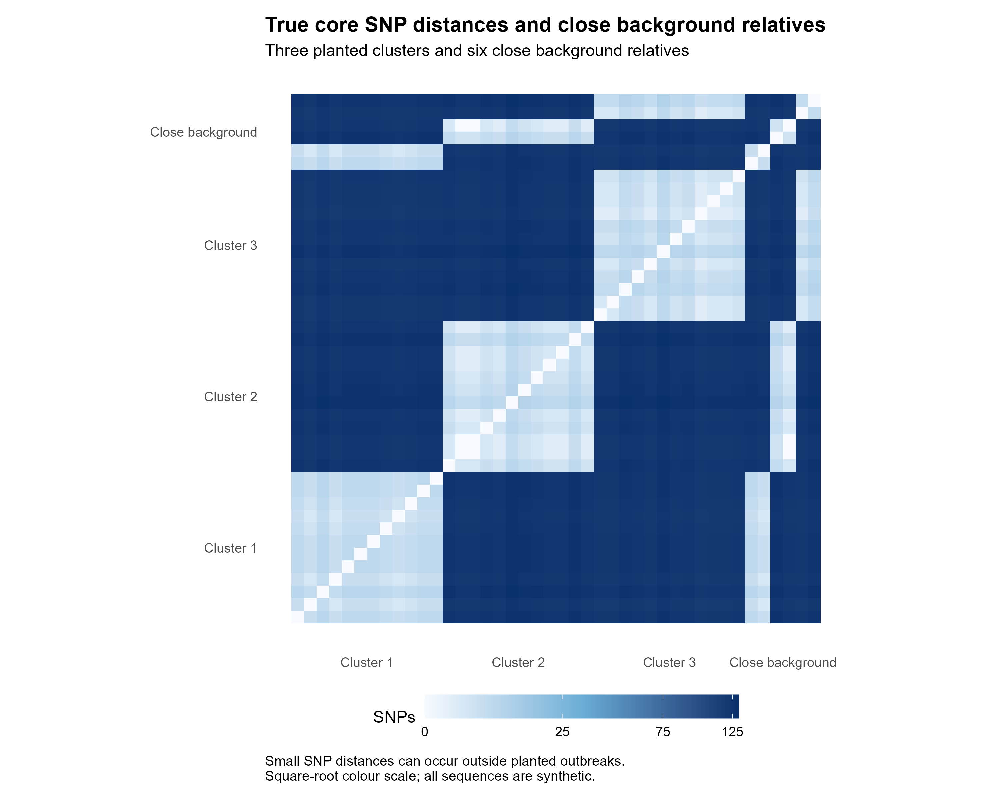

Resistance proportions differ across hospitals because hospital dependence was built into gene carriage and phenotypes. Numerical counts, Wilson intervals, genotype-phenotype cross-tabulations and adjusted mortality associations are available as result tables.

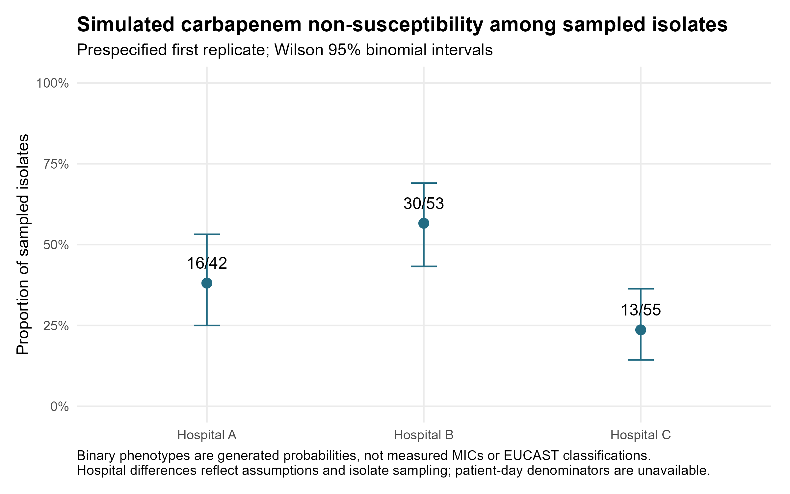

The local WSL Nextflow sequencing test completed; machine-readable checks are supplied in results/wgs/wgs_validation.json.

### Executed sequencing validation

All 12 fixtures completed read QC, mapping and consensus. The 10 high-depth fixtures had 99.46% to 99.76% callable core sites and at most 0 incorrect callable bases per 30-kb segment. The two low-depth controls had 2.86% to 5.58% callability and were excluded from phylogeny using observed callability below 90%. This confirms the expected quality-gate behaviour on these fixtures; it does not estimate clinical error rates.

The four selected assemblies recovered both expected positive targets and produced no target hits in either negative control. These four controls assess correct execution at adequate depth against the supplied references.

| Assembly fixture | Expected target | Detected target | Passed |
|---|---|---|---|
| WGS01 | blaKPC-2 | blaKPC-2 | True |
| WGS04 | None | None | True |
| WGS05 | blaNDM-1 | blaNDM-1 | True |
| WGS08 | None | None | True |

The observed-sequence tree retains close background relatives within the two genetic groups. Bootstrap support describes stability of genetic splits under the fitted model; it cannot distinguish a planted outbreak link from shared ancestry. Low-diversity tip relationships can remain uncertain.

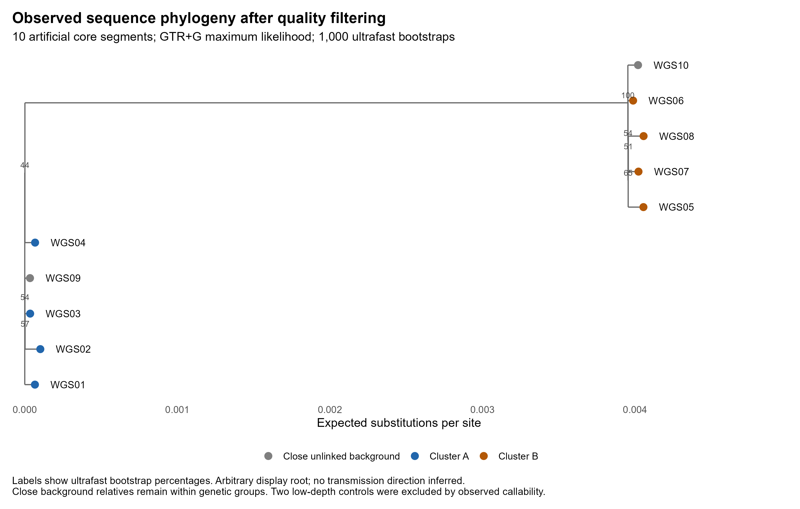

### Public genome case study and publication concordance

All 12 public assemblies passed the callability gate. Their individual pre-repeat-mask chromosome callability ranged from 98.25% to 99.72%. Assembly N50 ranged from 120.8 to 5395.3 kb; the two complete assemblies account for the upper end. Continuity and callability measure different properties, so the complete-versus-draft difference is not interpreted as a biological difference.

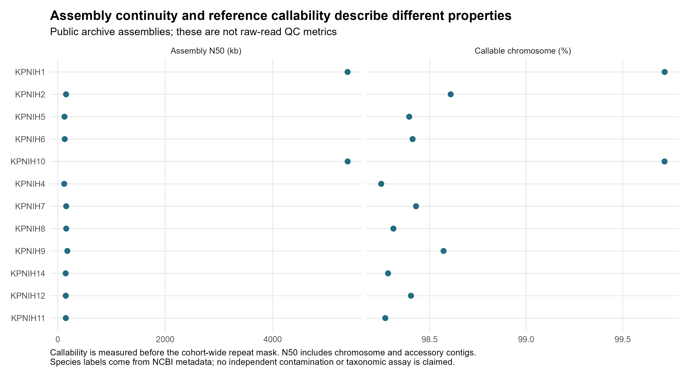

Exact seven-locus typing assigned ST258 to 12/12 assemblies. KPC-family genes were detected in 12/12, with observed calls blaKPC-3. These findings are concordant with the publication-level lineage and carbapenemase expectations. Concordance within a selected positive outbreak subset does not estimate diagnostic sensitivity, specificity or performance in unrelated isolates.

| Isolate | Assembly accession | Observed ST | KPC gene | Publication checks |
|---|---|---:|---|---|
| KPNIH1 | GCA_000281535.2 | 258 | blaKPC-3 | Concordant |
| KPNIH2 | GCA_000281255.1 | 258 | blaKPC-3 | Concordant |
| KPNIH4 | GCA_000281395.1 | 258 | blaKPC-3 | Concordant |
| KPNIH5 | GCA_000281275.1 | 258 | blaKPC-3 | Concordant |
| KPNIH6 | GCA_000281295.1 | 258 | blaKPC-3 | Concordant |
| KPNIH7 | GCA_000281415.1 | 258 | blaKPC-3 | Concordant |
| KPNIH8 | GCA_000281555.1 | 258 | blaKPC-3 | Concordant |
| KPNIH9 | GCA_000281315.1 | 258 | blaKPC-3 | Concordant |
| KPNIH10 | GCA_000281435.2 | 258 | blaKPC-3 | Concordant |
| KPNIH11 | GCA_000281575.1 | 258 | blaKPC-3 | Concordant |
| KPNIH12 | GCA_000281335.1 | 258 | blaKPC-3 | Concordant |
| KPNIH14 | GCA_000281455.1 | 258 | blaKPC-3 | Concordant |

The complete AMRFinder table records the supporting method, coverage, identity and reference accession for each call. The heatmap contains 15 distinct antibiotic-resistance gene calls, of which 15 are shared by all twelve assemblies. This shared profile provides little discrimination within the selected outbreak. Stress-associated elements remain available in the full table. Gene presence is not a measurement of drug susceptibility.

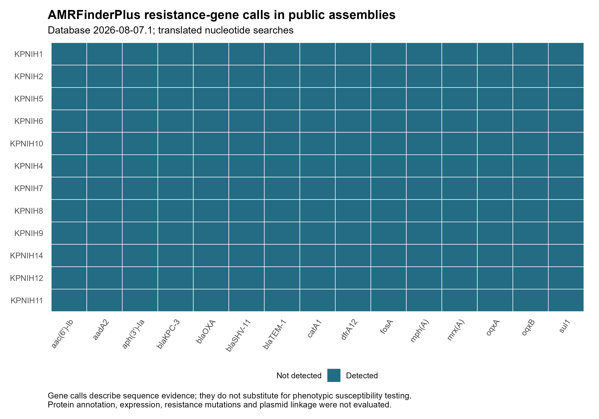

After shared masking, 5,211,693 chromosome sites remained (96.62% of the reference), including 42 variable sites. Pairwise distances ranged from 0 to 25 SNPs, with median 16.5 and interquartile range 7.0–20.0. The original paper reported 41 variable sites among 18 outbreak isolates. Our 42-site count uses twelve genomes, two later assembly versions and a strict chromosome-only mask. It supports a low-diversity interpretation but is not an exact numerical replication or a validated transmission cutoff.

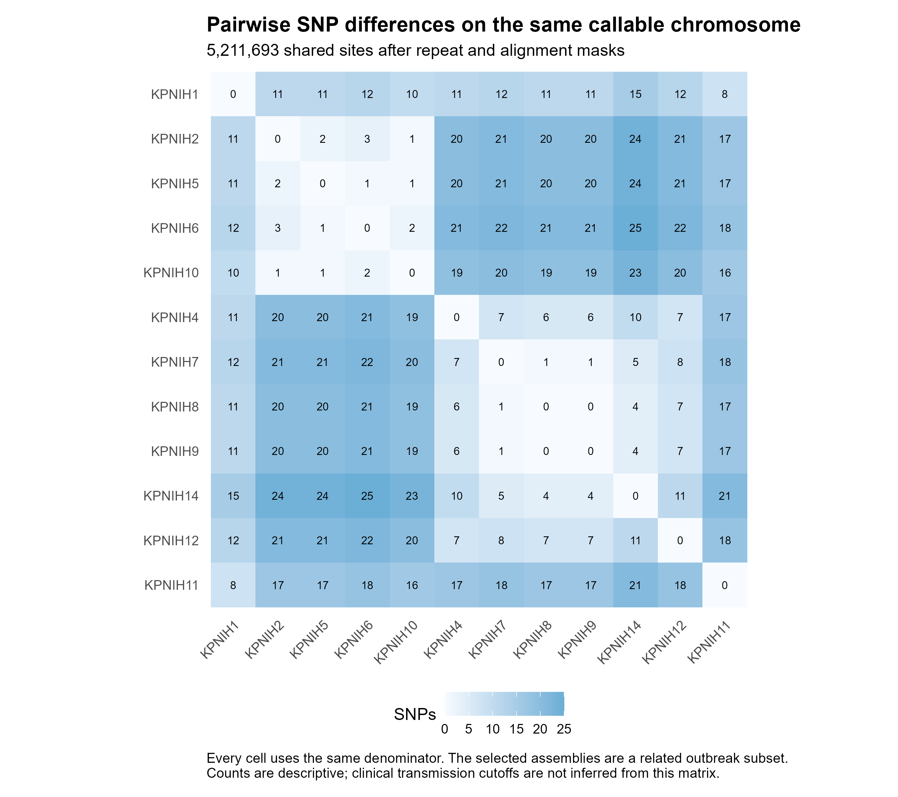

The maximum-likelihood tree resolves genetic substructure within ST258, while some short internal branches have weak bootstrap support. Near-identical genomes can have uncertain ordering. Neither the topology nor SNP distances establishes a source patient or direction of spread without the original epidemiological evidence.

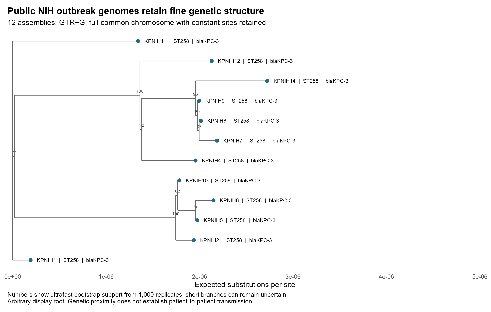

[Public sample accessions](../../case_study/config/samples.tsv) | [Publication concordance](../../case_study/results/publication_validation.csv) | [Assembly QC and typing](../../case_study/results/assembly_qc_typing.csv) | [AMRFinder evidence](../../case_study/results/amrfinder_all_hits.csv) | [SNP distances](../../case_study/results/core_pairwise_distances.csv) | [Observed tree](../../case_study/results/phylogeny/public.treefile)

## Discussion

The public case study adds a biological execution check to the simulation results: established typing and resistance-family findings are recovered from published bacterial assemblies. It does not validate the simulation precision estimates in patients. All twelve genomes come from one selected outbreak, with no negative-control collection and incomplete clinical metadata. Archive assemblies also conceal raw-read error, contamination and assembly uncertainty. The 42-versus-41 variable-site difference requires raw-read and site-level reconciliation before claiming exact replication; the present report retains that discrepancy rather than tuning the method to match the paper.

The study supports an analytical principle under explicit assumptions: combine sequence relatedness with epidemiological information, and quantify what surveillance cannot observe. The baseline precision advantage is large partly because background isolates share the same low-diversity founders as outbreaks. It is not an empirical estimate of the value of NICD surveillance. Missing data are generated independently; outcome-dependent sampling, ward transfers, cross-hospital spread and missingness related to clinical severity could behave differently.

The strict ward-and-date rule can miss real spread across wards or long intervals. Unsampled intermediates are not reconstructed. The pairwise observation model is not a replacement for read simulation, and the small sequencing experiment validates computational behaviour rather than genomic realism. Recombination masking, species confirmation, MLST, contamination mixtures, plasmid reconstruction and larger external clinical datasets would be needed for a production bacterial-genomics study.

The two-gene screen deliberately tests known positive and negative computational controls. It does not establish sensitivity to novel alleles, fragmented genes, divergent databases or phenotypic resistance. Synthetic mortality associations are illustrative and do not justify therapeutic recommendations.

## Conclusion

The simulations quantify detection tradeoffs under known truth, while the public genome case study recovers the reported ST258 lineage and KPC-family resistance determinant. Their complementary evidence supports an auditable workflow with explicit quality gates and reference versions. Exact variant replication, resistance phenotypes and patient transmission require additional evidence beyond this selected assembly-based reanalysis.

## Reproducibility

The original simulation results remain unchanged. The baseline Word report, Quarto source and README snapshot are retained under report/archive, and the simulation-baseline-20261122 Git tag preserves the original release. The case study has its own inputs, workflow, results and figures under case_study. SHA256 checks verify preservation of the original simulation data, figures and execution records.

[Original simulation Word report](../../report/archive/Hospital_AMR_Simulation_Baseline.docx) | [Preserved simulation checksums](../../case_study/provenance/preserved_simulation_sha256.json) | [Public input manifest](../../case_study/provenance/input_manifest.json)

The project is stored on Toshiba at `D:/Hospital-AMR-Genomic-Surveillance`. Statistical analyses and figures use R; Python generates and checks short-read fixtures; Nextflow orchestrates Linux sequencing tools. All simulation configurations, seeds, synthetic metadata, summary tables and Newick trees are public. No correspondence or private clinical data are included.

```sh
Rscript --vanilla scripts/restore.R
Rscript --vanilla scripts/run.R
Rscript --vanilla tests/test_simulation.R
python3 scripts/prepare_wgs.py
nextflow run main.nf -resume
Rscript --vanilla scripts/plot_wgs.R
Rscript --vanilla scripts/build_report.R
Rscript --vanilla scripts/render_report.R
Rscript --vanilla scripts/audit.R
```

Activate the Linux environment in environment.yml before running Nextflow. The pinned conda specification is supplied for recreation; recorded local tool versions document the actual execution environment. Transitive dependency resolution may change. The Windows report renderer locates the installed RStudio Quarto executable when it is not on PATH.

For the public case study, activate case_study/environment.yml, fetch the locked inputs and database source files, and build the database indexes. An existing verified database directory can be supplied through --amr_db to avoid downloading it again. See RUN_WORKFLOW.txt for Toshiba and WSL paths.

```sh
python3 case_study/scripts/fetch_inputs.py --amr
amrfinder_index case_study/cache/amrfinder/2026-08-07.1
python3 case_study/scripts/test_assembly_analysis.py -v
nextflow -C case_study/nextflow.config run case_study/main.nf -resume
Rscript --vanilla case_study/analyse.R
python3 case_study/scripts/audit.py
Rscript --vanilla scripts/build_report.R
Rscript --vanilla scripts/render_report.R
```

[Word report](report/Hospital_AMR_Report.docx) | [Quarto source](report/Hospital_AMR_Report.qmd) | [Performance tables](../../results/performance_summary.csv) | [Clinical associations](../../results/mortality_associations.csv) | [Full tree](../../results/full_synthetic_tree.nwk) | [R validation](../../provenance/R_validation.json)

## References

1. NICD. Centre for Healthcare-Associated Infections, Antimicrobial Resistance and Mycoses. https://www.nicd.ac.za/centres/centre-for-healthcare-associated-infections-antimicrobial-resistance-and-mycoses/

2. NCBI. AMRFinderPlus and Reference Gene Database. https://www.ncbi.nlm.nih.gov/pathogens/antimicrobial-resistance/AMRFinder/

3. Minh BQ et al. IQ-TREE 2. Molecular Biology and Evolution. 2020;37:1530-1534. https://doi.org/10.1093/molbev/msaa015

4. Core/Whole Genome Multilocus Sequence Typing and Core Genome SNP-Based Typing of OXA-48-Producing Klebsiella pneumoniae Clinical Isolates From Spain. Front Microbiol. 2019;10:2961. https://doi.org/10.3389/fmicb.2019.02961

5. Snitkin ES et al. Tracking a hospital outbreak of carbapenem-resistant Klebsiella pneumoniae with whole-genome sequencing. Sci Transl Med. 2012;4:148ra116. https://doi.org/10.1126/scitranslmed.3004129

6. PubMLST Klebsiella pneumoniae sequence definitions. https://pubmlst.org/organisms/klebsiella-pneumoniae | Pinned allele mirror: https://github.com/tseemann/mlst/tree/dd2ae883f721b9049fbbe4ab92e2db1ba9c100ed/db/pubmlst/klebsiella
