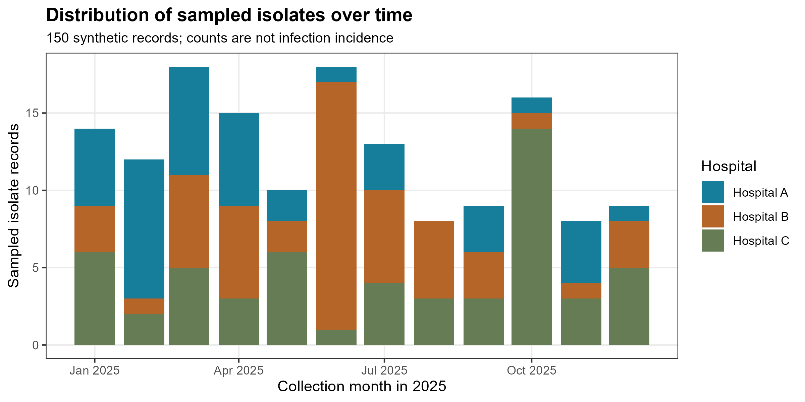
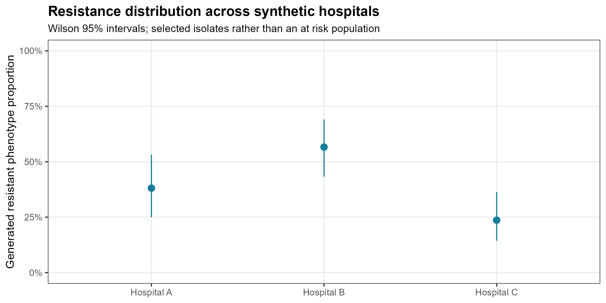
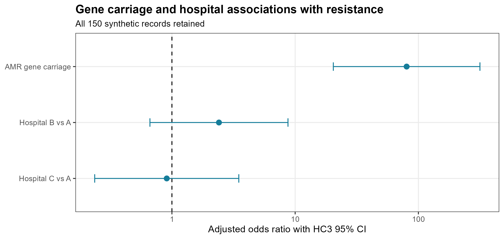
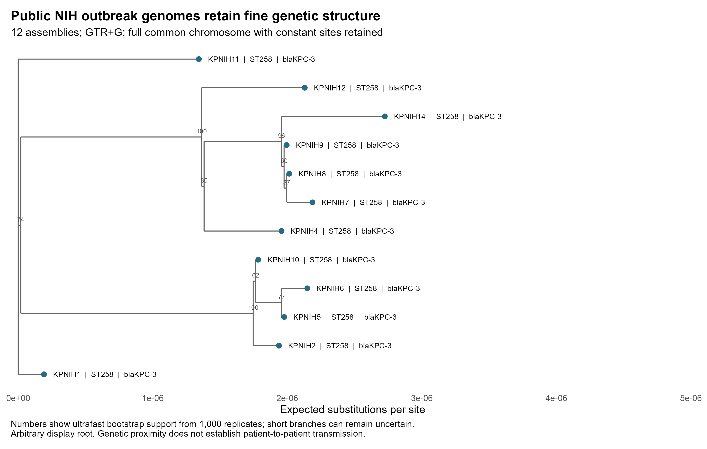

```{r}
library(flextable)
```

## Abstract

**Background.** Hospital surveillance asks how resistance is distributed across sampled patients and whether genetic determinants align with phenotypes and clinical outcomes. **Aim.** To describe resistance, genomic relatedness and exploratory clinical associations in a synthetic hospital cohort, with a separate descriptive reanalysis of public outbreak assemblies. **Methods.** R analysed one saved cohort of 150 people with one isolate each. We summarised hospital and time distributions, cross-tabulated gene carriage and resistance, and fitted hospital-adjusted logistic regression. A published 12-assembly NIH Klebsiella pneumoniae subset supplied a separate measured-genome case study.

**Results.** There were 59 generated resistant phenotypes and 21 generated deaths. The hospital-adjusted gene-carriage OR for resistance was 80.27 (20.40, 315.83). All 12 public assemblies were ST258 and carried KPC-family genes. **Conclusion.** The synthetic cohort illustrates heterogeneous resistance and gene-phenotype associations; the selected public assemblies describe a closely related resistant lineage. Neither analysis establishes hospital infection incidence or direct transmission.

## Introduction

Resistance surveillance combines the distribution of laboratory findings with the setting and timing of patient care. Genomic relatedness can support an outbreak investigation, but similar genomes alone do not identify who infected whom. The present analysis centres on resistance distributions and clinical associations. The earlier candidate-link benchmarks and sequencing execution tests remain supplementary technical evidence, preserved without changing their results.

### Aim and objectives

The primary aim was to characterise generated phenotypic resistance among sampled hospital isolates and its association with AMR gene carriage after hospital adjustment. Objectives were to describe the cohort by hospital and sampling time; compare gene carriage with phenotype; examine the previously fitted mortality association as exploratory; and describe lineage, resistance determinants and genomic distances in the separate public outbreak subset.

## Methods

### Study populations and preprocessing

The primary analytical dataset is the saved first synthetic population: 150 distinct people, three fictional hospitals and three ward categories, with one isolate per person during 2025. All participant, gene, phenotype and mortality values are simulated. We verified unique identifiers, finite complete analysis variables and valid binary coding. No record or outcome was regenerated, imputed or excluded. Three planted clusters share hospital, ward and collection windows; random core haplotypes approximate genomic relatedness and are not reconstructed K. pneumoniae genomes.

The separate public component consists of 12 accession-versioned NIH outbreak assemblies, a convenience subset of the original publication. It contains measured bacterial sequence data but does not supply an independent patient cohort, measured phenotypic susceptibility results or complete patient contact histories. It is not pooled with the simulated cohort. Assembly QC, exact seven-locus MLST, AMRFinderPlus, masked reference projection and full common-core maximum-likelihood phylogenetics were completed previously; their inputs, versions and original outputs remain unchanged.

### Outcomes and estimands

The primary outcome is the binary generated resistant phenotype, coded 1 versus 0. Gene carriage is a binary simulated marker that receives blaKPC-2 or blaNDM-1 labels when present; those labels do not constitute biological sequencing measurements in this cohort. The secondary clinical outcome is generated death, with no fixed follow-up duration supplied. It is therefore analysed as a binary outcome rather than a survival endpoint. Hospital proportions describe selected isolate records. Patient admissions and patient-day denominators are unavailable, so infection incidence and hospital-wide prevalence cannot be estimated.

### Statistical analysis

Descriptive statistics use counts, proportions, age mean and SD, and Wilson 95% intervals for resistance proportions. With resistant outcome R, gene indicator G and hospital indicators B and C, the primary model was

$$\operatorname{logit}\Pr(R_i=1)=\alpha+\beta_GG_i+\beta_BB_i+\beta_CC_i.$$

Odds ratios were exp(beta), with HC3 sandwich Wald 95% confidence intervals. The model assumes an adequate conditional logit relationship and independent people conditional on the included covariates. HC3 addresses leverage-dependent variance estimation; it does not remove unmeasured confounding or validate the synthetic mechanism. Convergence, design rank, separation and influence were checked, with all records retained. No stepwise selection was used.

The preserved mortality model adjusted for gene carriage, age, severity and hospital. Its original conventional Wald intervals are labelled separately from HC3 intervals. Only 21 deaths support that exploratory model, so estimates may be unstable. We independently refitted it to verify the saved ORs without replacing the original result file. All association tests are exploratory, not confirmatory biomarker validation. Public-genome results are descriptive; related isolates and their pairwise SNP distances are not independent population observations.

## Results

### Population and time distribution

The cohort table describes the denominator for each hospital comparison. Differences are properties of the generated sample and were not used to select model covariates.

::: {custom-style="Table Caption"}
Table 1 Characteristics of the 150 synthetic isolate associated people
:::

```{r}
#| echo: false
readRDS("../epidemiology/tables/population.rds")
```

The epidemic curve shows when isolate records were sampled and how their hospital distribution changed over the year. Peaks are partly imposed by the planted cluster windows. The plot does not estimate a disease rate or establish hospital transmission.

{width=6.3in}

### Resistance and gene phenotype associations

Hospital-specific resistant proportions vary in this selected synthetic cohort. Wilson intervals describe binomial sampling uncertainty under independent observations; they do not account for a representative hospital surveillance design or residual cluster dependence.

::: {custom-style="Table Caption"}
Table 2 Generated resistance among sampled isolates by hospital
:::

```{r}
#| echo: false
readRDS("../epidemiology/tables/hospital_resistance.rds")
```

{width=6.3in}

The cross-tabulation distinguishes gene carriage from the generated phenotype. Discordance is possible because phenotype was generated probabilistically. A detected resistance gene is therefore not presented as a measured susceptibility test.

::: {custom-style="Table Caption"}
Table 3 Gene carriage and generated phenotypic resistance
:::

```{r}
#| echo: false
readRDS("../epidemiology/tables/concordance.rds")
```

After hospital adjustment, gene carriage was associated with higher generated resistance odds: OR 80.27 (20.40, 315.83), p <0.001. This association reflects the simulation mechanism and does not validate a clinical test.

::: {custom-style="Table Caption"}
Table 4 Hospital adjusted resistance associations with HC3 confidence intervals
:::

```{r}
#| echo: false
readRDS("../epidemiology/tables/associations.rds")
```

{width=6.3in}

### Exploratory mortality association

The previously fitted mortality association for gene carriage was OR 3.76 (1.36, 10.36), p 0.011. With 21 deaths and several adjustment parameters, this result warrants particular caution. It describes a generated association and does not establish that resistance caused death.

::: {custom-style="Table Caption"}
Table 5 Preserved exploratory mortality model with conventional Wald intervals
:::

```{r}
#| echo: false
readRDS("../epidemiology/tables/mortality.rds")
```

### Public outbreak genome findings

All 12 selected public assemblies belonged to ST258 and carried blaKPC-3. The common callable chromosome contained 42 variable sites, with pairwise distances from 0 to 25 SNPs. These results support the presence of a closely related resistant lineage in this published outbreak subset. They do not identify individual transmission events or imply that the subset represents circulating organisms across hospitals.

::: {custom-style="Table Caption"}
Table 6 Public NIH outbreak subset genomic findings
:::

```{r}
#| echo: false
readRDS("../epidemiology/tables/public.rds")
```

{width=6.3in}

## Discussion

The epidemiological findings concern resistance distribution, gene-phenotype association and the limits of interpreting genomic relatedness. In the synthetic cohort, gene carriage and hospital context describe different aspects of the observed resistance pattern. The separate public analysis supplies measured genomic evidence of an established outbreak lineage. Its concordance with the original publication is supporting context, rather than a new validation cohort.

The main limitations are generated phenotypes, a selected sample with no infection-free comparison population, limited mortality events, simplified genomic ancestry and absent patient-day denominators. Hospital differences may reflect case mix and ascertainment. A phylogeny alone cannot establish acquisition location or direction of spread. No phenotype prediction from the public assemblies, clinical threshold recommendation or causal effect is claimed.

## Conclusion

This study presents an applied hospital resistance analysis with explicit denominators, adjusted associations and genomic context. The numerical associations are entirely synthetic; the public assemblies provide a separate descriptive outbreak reanalysis. The earlier accuracy benchmarks remain available as supplementary methods results.

## Reproducibility and supporting analyses

Run `Rscript --vanilla epidemiology/analysis.R --report` from the repository root after installing the packages listed in `epidemiology/R_packages.csv` and Quarto. This command reuses saved data, creates tables and figures, checks original-file hashes and renders the Word report. Sequencing and original simulation workflows remain available through `main.nf`, `case_study/main.nf` and `RUN_WORKFLOW.txt`. Their computational requirements and results are documented in the archived manuscript. The analysis assumes no NICD affiliation or endorsement.

The archived README retains the complete original candidate-link benchmark, sequencing validation, database versions and publication references. Public genome provenance is retained in `case_study/provenance`. Data, estimates and figures that predate this refocus are protected by `epidemiology/original_results_manifest.json`.

## References

1. Snitkin ES and colleagues. Tracking a hospital outbreak of carbapenem resistant Klebsiella pneumoniae with whole genome sequencing. Science Translational Medicine 2012;4:148ra116. [Original outbreak study](https://doi.org/10.1126/scitranslmed.3004129).
2. NICD Centre for Healthcare Associated Infections Antimicrobial Resistance and Mycoses. [Surveillance context](https://www.nicd.ac.za/centres/centre-for-healthcare-associated-infections-antimicrobial-resistance-and-mycoses/).

