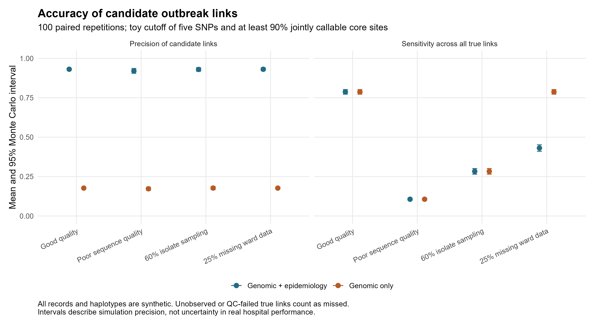
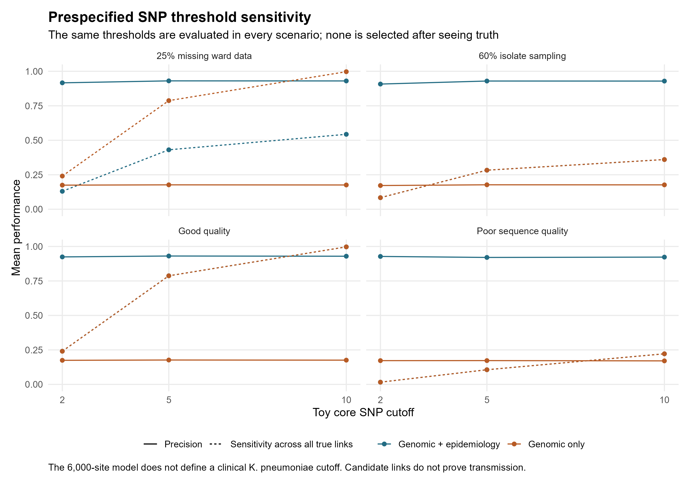
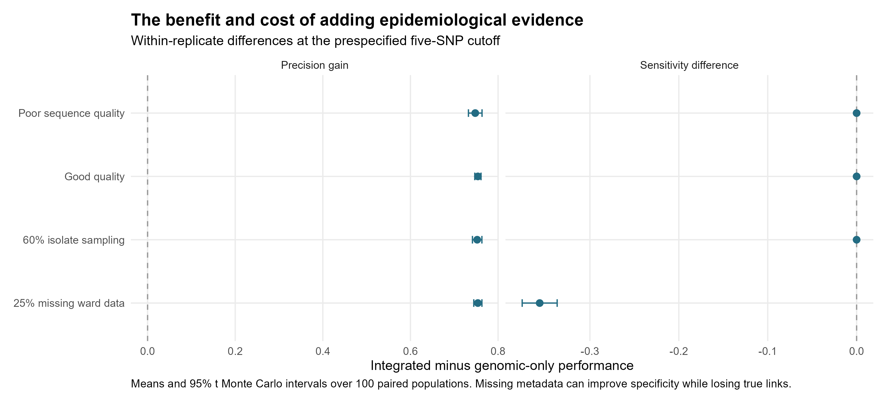
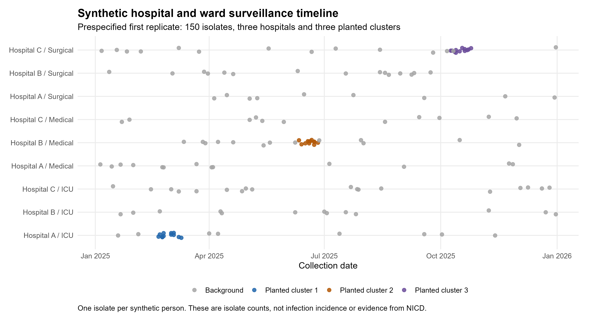
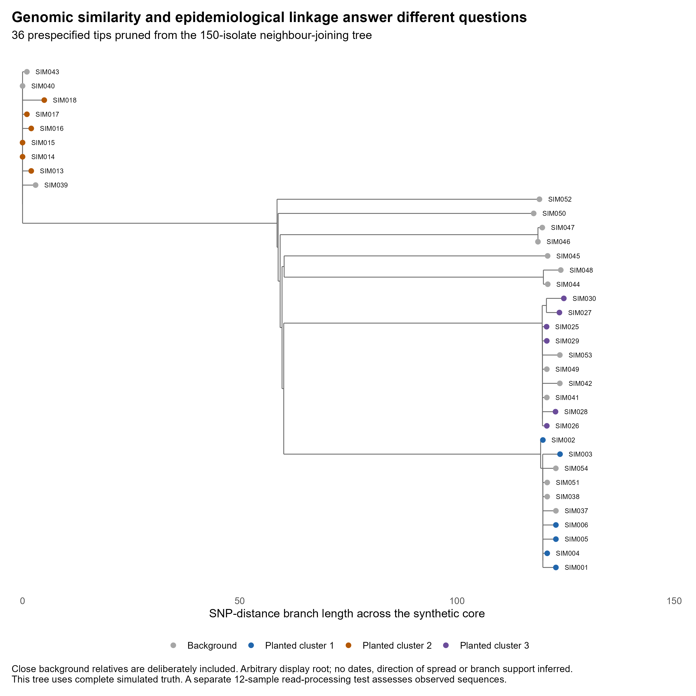
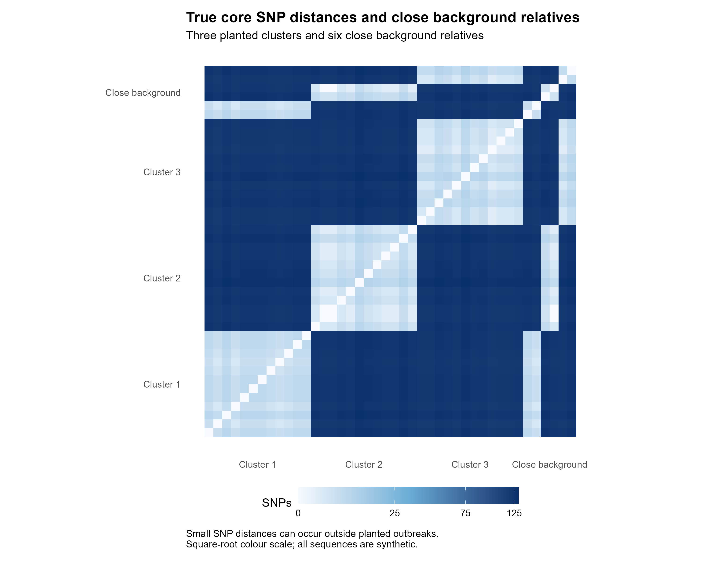
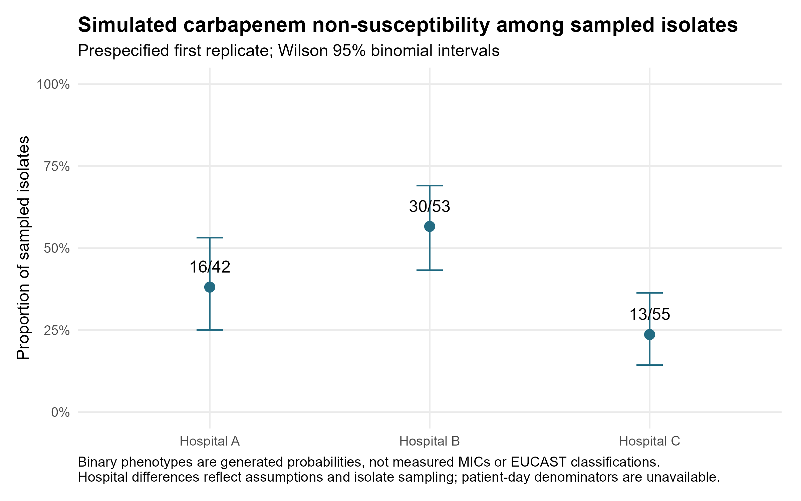
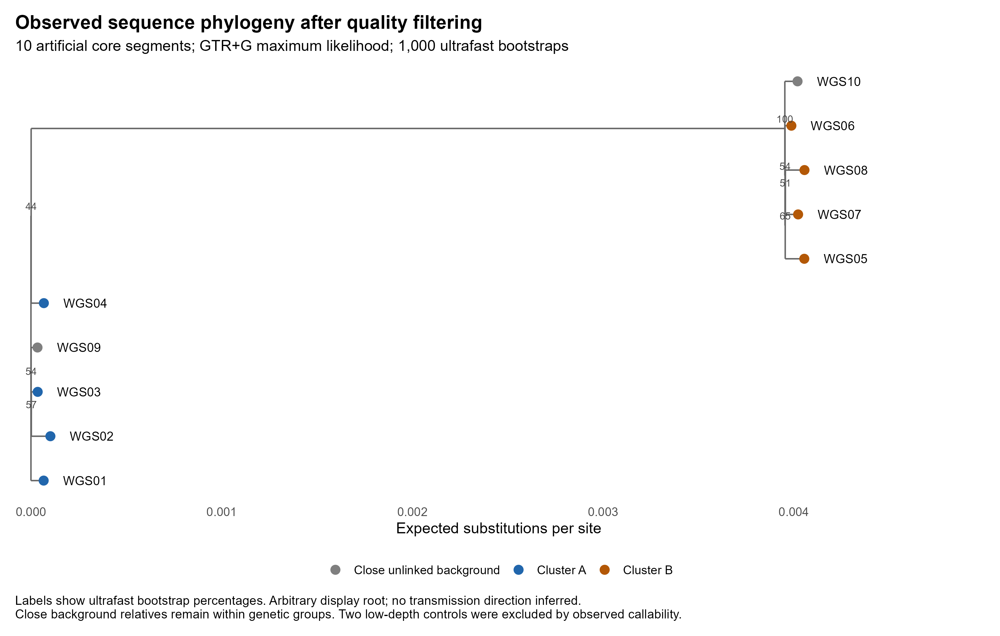

## Abstract

**Fully synthetic research demonstration. No NICD, CHARM or patient data are used. This independent project has no institutional affiliation or endorsement.** We evaluated candidate outbreak links using genetic distance alone and genetic distance combined with hospital, ward and collection-date information. One hundred independently seeded populations of 150 isolates were assessed under four paired observation scenarios and three prespecified thresholds. A separate compact Nextflow experiment processes artificial short-read data with standard sequencing tools.

At the primary toy threshold, adding epidemiological evidence increased mean precision from 17.7% to 93.1% in the baseline scenario, with sensitivity of 78.7% for both methods. Missing metadata reduced integrated sensitivity to 43.1%. These results quantify consequences of the simulation assumptions rather than performance in actual hospitals.

## Introduction

Healthcare-associated infection surveillance links laboratory findings to the place and time of patient care. Related bacterial isolates can indicate a common circulating lineage, an outbreak, or other shared ancestry. Genetic similarity therefore needs epidemiological interpretation. The work is motivated by the surveillance and bioinformatics activities described by the NICD Centre for Healthcare-Associated Infections, Antimicrobial Resistance and Mycoses [1].

The clinical motivating organism is carbapenem-resistant Klebsiella pneumoniae. However, the generated core haplotypes are random computational sequences, not reconstructed K. pneumoniae genomes. The aim is methodological: determine when metadata improve candidate-link precision and when incomplete ascertainment or poor quality limits recovery of known links.

## Methods

### Population and sequence model

Each synthetic population contains 150 distinct people with one isolate each, three hospitals, three ward categories and collection dates within 2025. Three planted clusters contain 12 isolates each and share a hospital, ward and a 21-day collection period. Twelve lineage founders are formed by changing 60 sites in a common 6,000-site random ancestor. Each isolate receives Poisson(2) private substitutions. Background isolates can share founders with outbreak isolates; six deliberately close background comparators have collection dates outside the outbreak windows. Cluster membership is an evaluation label and does not enter detection.

$$d_{ij}=\sum_{\ell=1}^{L}\mathbf{1}(G_{i\ell}\ne G_{j\ell}),\qquad L=6000.$$

This deliberately simple, nonrecombining ancestry model omits real bacterial population structure, accessory-genome diversity and within-host evolution. All background members of the same founder can be genetically close. The resulting challenge is intentionally unfavourable to genomic-only inference; a large precision advantage should not be generalised to every surveillance setting.

### Observation and prespecified detection rules

Baseline per-isolate site call probability is 0.995. Poor quality draws it uniformly from 0.87 to 0.99 and increases sequencing-error contributions. For each pair, jointly callable sites are binomial with success probability q_ij=q_i q_j; true differences are thinned with the same probability and independent false differences follow a Poisson distribution. Pair-level draws are an approximation and need not form a globally consistent alignment.

$$C_{ij}\sim\operatorname{Binomial}(L,q_iq_j),\quad \widetilde d_{ij}\sim\operatorname{Binomial}(d_{ij},q_iq_j)+\operatorname{Poisson}(2Lq_iq_j e).$$

Error rate e is 0.000001 at baseline and 0.0002 under poor quality. Pairs require at least 90% jointly callable sites. Genomic cutoffs 2, 5 and 10 are evaluated throughout, with 5 specified as the primary illustrative cutoff. They apply to the toy model and are not recommended clinical thresholds. Incomplete sampling retains each isolate independently with probability 0.6. Missing metadata deletes each ward independently with probability 0.25. Scenarios share the same population and observation random seed within replicate; they are paired stress tests, not independent cohorts.

$$A_{ij}=\mathbf{1}(\text{both sampled})\mathbf{1}(C_{ij}/L\ge0.90)\mathbf{1}(\widetilde d_{ij}\le k).$$

$$B_{ij}=A_{ij}\mathbf{1}(h_i=h_j)\mathbf{1}(w_i=w_j\text{ observed})\mathbf{1}(|t_i-t_j|\le30).$$

A and B define genomic-only and integrated candidate links. A planted true link joins two members of the same planted cluster, yielding 3 times choose(12,2), or 198 true pairs. An unsampled, failed-QC or metadata-ineligible true pair counts as missed in population sensitivity. Conditional sensitivity among sampled true pairs is exported separately. Precision is undefined when no candidate links are called; its valid-replicate count is retained. Connected components are provided only as descriptive candidate clusters: single-linkage chaining can join isolates whose direct pair fails the rule.

$$\operatorname{Precision}=\frac{TP}{TP+FP},\qquad\operatorname{Sensitivity}_{all}=\frac{TP}{198},\qquad\operatorname{Sensitivity}_{sampled}=\frac{TP}{N_{true,sampled}}.$$

Means and 95% t Monte Carlo intervals use independent replicate-level estimates. Paired differences use integrated minus genomic-only estimates within the same replicate. These intervals describe precision of simulated averages, not independent-pair uncertainty or clinical confidence intervals. Missing-metadata sensitivity is expected to scale approximately with 0.75 squared, and population sensitivity under 60% independent isolate sampling with 0.60 squared.

### Sequencing experiment and AMR controls

Twelve artificial 30-kb core segments, with two related groups and background comparators, form a separate pipeline-validation dataset. Ten have expected depth 28 and two have expected depth 2. The read generator supplies 150-bp paired reads, insert length 320 and substitution error 0.0001. These sequences are non-biological fixtures. Real public blaKPC-2 and blaNDM-1 nucleotide reference records from NCBI AMRFinderPlus release 2026-08-07.1 serve as computational accessory-sequence positive controls; accessions and SHA256 checksums are retained [2].

Nextflow coordinates fastp QC, BWA alignment, samtools sorting and depth, haploid bcftools calls, depth masking and consensus. Calls require quality 20 and depth 5; core positions below depth 5 become N. Four selected fixtures undergo SPAdes assembly and BLASTn screening of the two targets, using at least 95% identity and 90% reference-length coverage. This targeted screen is not an executed AMRFinderPlus analysis or a complete resistome. Gene presence does not establish drug susceptibility.

IQ-TREE estimates a GTR+G maximum-likelihood tree from QC-passing observed full-core alignments with 1,000 ultrafast bootstraps and a fixed seed [3]. The separate R neighbour-joining tree uses complete truth distances; it is arbitrarily rooted for display and does not establish transmission direction. Tool installation environments and execution records accompany the workflow.

### Descriptive surveillance and clinical associations

One prespecified population illustrates monthly isolate counts, Wilson intervals for simulated resistance proportions and Fisher testing of hospital differences. Synthetic gene carriage depends on hospital and planted-cluster membership; binary phenotypic non-susceptibility probabilities are 0.90 in carriers and 0.08 otherwise. These are not measured MICs. Mortality is generated by logistic(-2.5+0.5 gene+0.8 severity+0.015(age-55)), then analysed using logistic regression with gene, age, severity and hospital. The single-cohort Wald intervals and P values are exploratory. No causal effect, incidence rate, clinical prediction accuracy or real resistance burden is inferred.

## Results

All 100 populations completed, giving 400 scenario observations and 2,400 threshold-method evaluations. The primary comparison demonstrates that close relatives outside planted outbreaks create false candidate links under a genomic-only rule. Metadata improve precision in this deliberately challenging model.

| Scenario | Genomic-only precision | Integrated precision | Genomic-only sensitivity | Integrated sensitivity |
|---|---:|---:|---:|---:|
| Good quality | 17.7% | 93.1% | 78.7% | 78.7% |
| Poor sequence quality | 17.3% | 92.1% | 10.6% | 10.6% |
| 60% isolate sampling | 17.7% | 93.0% | 28.3% | 28.3% |
| 25% missing ward data | 17.7% | 93.1% | 78.7% | 43.1% |



Increasing the SNP threshold changes candidate-link recovery and false positives. The full prespecified grid is retained; no cutoff is optimised using the evaluation labels.



Paired contrasts isolate the change caused by requiring epidemiological agreement. The apparent gain in precision comes with lost true links when ward information is missing. Quality filtering and incomplete sampling limit both methods.



The first seeded population shows temporal concentration of planted clusters against year-round background observations. These counts describe sampled isolates and cannot estimate incidence without population or patient-day denominators.



Genetically close background isolates illustrate why a phylogenetic grouping alone cannot identify a transmission chain. The full 150-tip Newick tree is retained; 36 prespecified tips are shown for readability.



The SNP-distance heatmap highlights close background relatives as well as the planted groups. The heatmap and tree are descriptive views of the same complete-truth data, not independent validation.



Resistance proportions differ across hospitals because hospital dependence was built into gene carriage and phenotypes. Numerical counts, Wilson intervals, genotype-phenotype cross-tabulations and adjusted mortality associations are available as result tables.



The local WSL Nextflow sequencing test completed; machine-readable checks are supplied in results/wgs/wgs_validation.json.

### Executed sequencing validation

All 12 fixtures completed read QC, mapping and consensus. The 10 high-depth fixtures had 99.46% to 99.76% callable core sites and at most 0 incorrect callable bases per 30-kb segment. The two low-depth controls had 2.86% to 5.58% callability and were excluded from phylogeny using observed callability below 90%. This confirms the expected quality-gate behaviour on these fixtures; it does not estimate clinical error rates.

The four selected assemblies recovered both expected positive targets and produced no target hits in either negative control. These four controls assess correct execution at adequate depth against the supplied references.

| Assembly fixture | Expected target | Detected target | Passed |
|---|---|---|---|
| WGS01 | blaKPC-2 | blaKPC-2 | True |
| WGS04 | None | None | True |
| WGS05 | blaNDM-1 | blaNDM-1 | True |
| WGS08 | None | None | True |

The observed-sequence tree retains close background relatives within the two genetic groups. Bootstrap support describes stability of genetic splits under the fitted model; it cannot distinguish a planted outbreak link from shared ancestry. Low-diversity tip relationships can remain uncertain.



## Discussion

The study supports an analytical principle under explicit assumptions: combine sequence relatedness with epidemiological information, and quantify what surveillance cannot observe. The baseline precision advantage is large partly because background isolates share the same low-diversity founders as outbreaks. It is not an empirical estimate of the value of NICD surveillance. Missing data are generated independently; outcome-dependent sampling, ward transfers, cross-hospital spread and missingness related to clinical severity could behave differently.

The strict ward-and-date rule can miss real spread across wards or long intervals. Unsampled intermediates are not reconstructed. The pairwise observation model is not a replacement for read simulation, and the small sequencing experiment validates computational behaviour rather than genomic realism. Recombination masking, species confirmation, MLST, contamination mixtures, plasmid reconstruction and larger external clinical datasets would be needed for a production bacterial-genomics study.

The two-gene screen deliberately tests known positive and negative computational controls. It does not establish sensitivity to novel alleles, fragmented genes, divergent databases or phenotypic resistance. Synthetic mortality associations are illustrative and do not justify therapeutic recommendations.

## Conclusion

Reproducible hospital genomic surveillance requires explicit detection rules, quality gates, sampling denominators and evidence from place and time. This independent synthetic study makes those choices auditable and tests them against known labels. It provides a reusable workflow and research demonstration while leaving clinical conclusions to appropriately validated real data.

## Reproducibility

The project is stored on Toshiba at `D:/Hospital-AMR-Genomic-Surveillance`. Statistical analyses and figures use R; Python generates and checks short-read fixtures; Nextflow orchestrates Linux sequencing tools. All simulation configurations, seeds, synthetic metadata, summary tables and Newick trees are public. No correspondence or private clinical data are included.

```sh
Rscript --vanilla scripts/restore.R
Rscript --vanilla scripts/run.R
Rscript --vanilla tests/test_simulation.R
python3 scripts/prepare_wgs.py
nextflow run main.nf -resume
Rscript --vanilla scripts/plot_wgs.R
Rscript --vanilla scripts/build_report.R
Rscript --vanilla scripts/render_report.R
Rscript --vanilla scripts/audit.R
```

Activate the Linux environment in environment.yml before running Nextflow. The pinned conda specification is supplied for recreation; recorded local tool versions document the actual execution environment. Transitive dependency resolution may change. The Windows report renderer locates the installed RStudio Quarto executable when it is not on PATH.

[Word report](https://github.com/Vusumuzi2Mabasa/Hospital-AMR-Genomic-Surveillance/blob/main/report/Hospital_AMR_Report.docx) | [Quarto source](https://github.com/Vusumuzi2Mabasa/Hospital-AMR-Genomic-Surveillance/blob/main/report/Hospital_AMR_Report.qmd) | [Performance tables](https://github.com/Vusumuzi2Mabasa/Hospital-AMR-Genomic-Surveillance/blob/main/results/performance_summary.csv) | [Clinical associations](https://github.com/Vusumuzi2Mabasa/Hospital-AMR-Genomic-Surveillance/blob/main/results/mortality_associations.csv) | [Full tree](https://github.com/Vusumuzi2Mabasa/Hospital-AMR-Genomic-Surveillance/blob/main/results/full_synthetic_tree.nwk) | [R validation](https://github.com/Vusumuzi2Mabasa/Hospital-AMR-Genomic-Surveillance/blob/main/provenance/R_validation.json)

## References

1. NICD. Centre for Healthcare-Associated Infections, Antimicrobial Resistance and Mycoses. https://www.nicd.ac.za/centres/centre-for-healthcare-associated-infections-antimicrobial-resistance-and-mycoses/

2. NCBI. AMRFinderPlus and Reference Gene Database. https://www.ncbi.nlm.nih.gov/pathogens/antimicrobial-resistance/AMRFinder/

3. Minh BQ et al. IQ-TREE 2. Molecular Biology and Evolution. 2020;37:1530-1534. https://doi.org/10.1093/molbev/msaa015

4. Core/Whole Genome Multilocus Sequence Typing and Core Genome SNP-Based Typing of OXA-48-Producing Klebsiella pneumoniae Clinical Isolates From Spain. Front Microbiol. 2019;10:2961. https://doi.org/10.3389/fmicb.2019.02961
